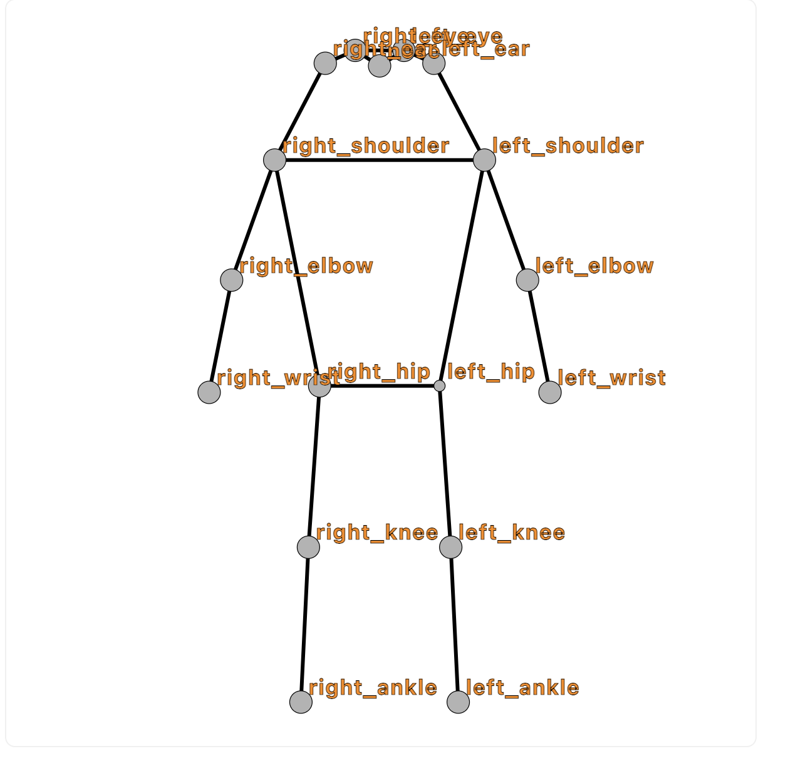
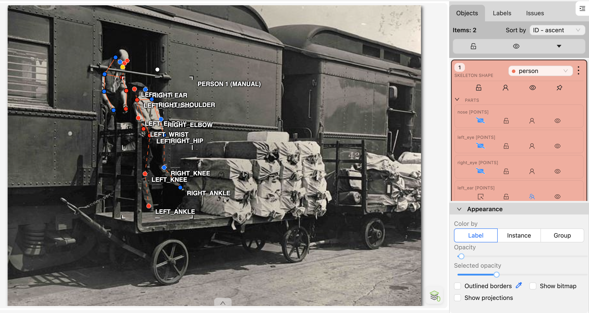
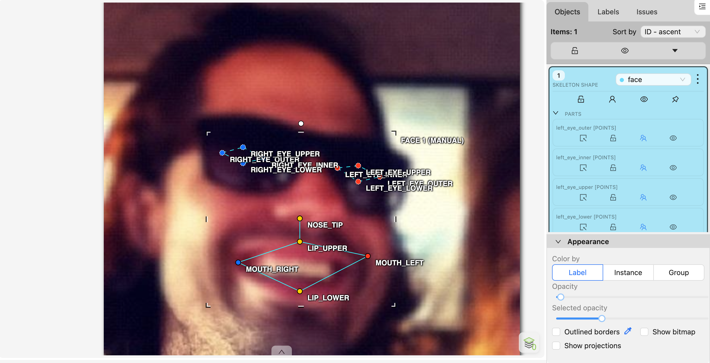
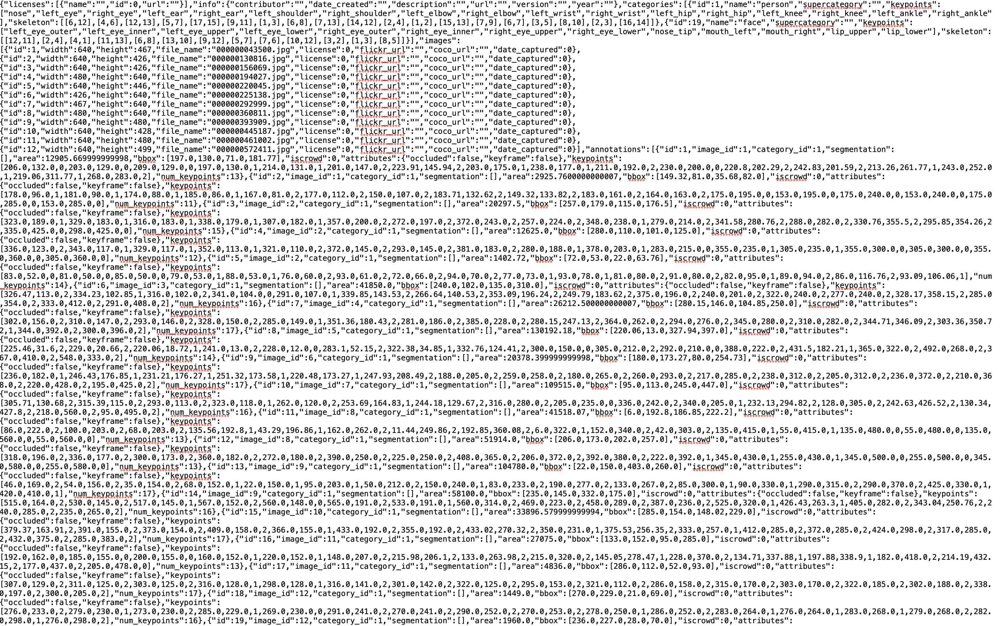

# Báo cáo cá nhân — TranQuangVinh-2A202603054

Dữ liệu: 12 ảnh người COCO val2017 (Lin et al., 2014) và 8 ảnh chân dung Wikimedia Commons, chỉ dùng trong lớp.

## 0. Thông tin học viên

- Họ tên: Trần Quang Vinh
- MSSV: 2A202603054
- Email: 26ai.vinhtq4@vinuni.edu.vn
- Link repository: https://github.com/gloryTran04/K5-L2-DAY04-TranQuangVinh-2A202603054-KeypointPose
- Phiên bản CVAT (Help → About): 2.82.0 (self-hosted, Docker, `http://localhost:8080`)
- Máy: hệ điều hành macOS 14.5 · RAM 8 GB (Docker được cấp 4,8 GB) · chạy CVAT chế độ đầy đủ
- Bộ ảnh (`src/exports/assignment.json` do `lab.py setup` tạo): có (user CVAT `vinh204`, task persons = 13, task faces = 14)
- Giờ bắt đầu: 16:50 ngày 12/11/2026 (chạy `lab.py setup`)
- Giờ kết thúc: 21:00

## 1. Kiểm tra label (CP0)

| Label | Kiểu | Số điểm | Tên điểm đúng bảng của lab? | Đúng thứ tự? | Số cạnh |
|---|---|---:|---|---|---:|
| `person` | Skeleton | 17 | Có | Có | 19 |
| `face` | Skeleton | 13 | Có | Có | 13 |

Mẫu `person` dựng theo người quay mặt về camera (các điểm `left_*` nằm bên phải khung mẫu)? **Có** (trong mẫu, `left_shoulder` ở x = 64, `right_shoulder` ở x = 36).

Cách đổi cờ `occluded` / `outside` cho **một điểm** trên phiên bản CVAT này (một câu):

Rê chuột lên đúng điểm đó rồi bấm `Q` để bật/tắt `occluded` (hoặc chuột phải vào điểm và chọn trong menu), và đặt `outside` cho riêng điểm đó (không dùng `hidden`, vì `hidden` chỉ ẩn trên giao diện, không ra `v = 0`).

## 2. Số lượng đã gán và thời gian (CP1, CP2)

| Nhóm ảnh | Số ảnh | Số skeleton đã gán | Số người dưới 60 px (không gán) | Số poster / gương / màn hình bỏ qua | Thời gian (phút) |
|---|---:|---:|---:|---:|---:|
| `easy` | 5 | 5 | 0 | 0 | — |
| `occluded` | 3 | 6 | 0 | 0 | — |
| `back` | 2 | 4 | 0 | 0 | — |
| `small` | 1 | 2 | ≥ 1 | 0 | — |
| `crowd` | 1 | 3 | 0 | 0 | — |
| `faces` | 8 | 8 | — | 0 | — |

Chi tiết số skeleton theo ảnh: `easy` 156069 = 1, 194027 = 1, 225138 = 1, 292999 = 1, 445187 = 1 · `occluded` 220045 = 2, 360811 = 2, 393909 = 2 · `back` 043500 = 2, 461002 = 2 · `small` 572411 = 2 · `crowd` 130816 = 3. Tổng 20 người, 8 mặt.


- Số ảnh người đã xong ở mốc phút 105: 12 / 10 (đã xong cả 12 ảnh)
- Thời gian thực tế (phút): không đo tách riêng từng CP; CP1 + CP2 + CP3 + CP4 tổng cộng khoảng 55 phút
- Ảnh tốn thời gian nhất là ảnh nào, vì sao?

`000000572411` (nhóm `small`): người trên tàu chỉ cao khoảng 69–70 px, hai người khoanh tay nên cổ tay bắt chéo, phải phóng to nhiều lần để đặt khuỷu và cổ tay, và phải đo chiều cao từng người để quyết định ai đủ 60 px. Tiếp theo là `000000130816` (`crowd`), có cầu thủ số 36 ở xa và quay lưng.

## 3. Bảng ca khó (CP1, CP2)

| Ảnh | Người / mặt | Điểm | Cờ đã chọn | Phân vân giữa | Lý do chọn |
|---|---|---|---:|---|---|
| 000000220045 | Người thứ 2 (chỉ thấy đôi giày) | Cả skeleton | gán | gán / không gán | Phần nhìn thấy cao đúng khoảng 60 px, đúng ngưỡng; giữ lại để không bị tính `missing` |
| 000000220045 | Người thứ 2 | `left_ankle`, `right_ankle` | 2 | 2 / 1 | Giày thấy rõ, cổ chân nằm ngay trên giày |
| 000000220045 | Người thứ 2 | 15 điểm còn lại | 0 | 1 / 0 | Thân nằm ngoài khung / bị che hoàn toàn, không ước lượng được vị trí |
| 000000043500 | Người bị toa tàu che | `left_hip` … `right_ankle` | 0 | 1 / 0 | Thân dưới bị toa tàu che kín, không có manh mối nào để ước lượng chắc, nên `outside` |
| 000000043500 | Người quay lưng | `nose`, `left_eye`, `right_eye` | 0 | 1 / 0 | Quay lưng hẳn, mặt không có trong ảnh; theo guideline mặt người quay lưng là `outside` |
| 000000043500 | Người quay lưng | `left_ear`, `right_ear` | 1 | 2 / 1 | Thấy viền tai sau tóc nhưng không rõ vị trí chính xác |
| 000000360811 | Cả hai người | Gối, cổ chân | 0 | 0 / kéo về mép ảnh | Khớp thật nằm ngoài khung; không kéo điểm về mép ảnh |
| 000000130816 | Cầu thủ số 36 (xa, quay lưng) | Cả skeleton | gán | gán / không gán | Đo chiều cao khoảng 65 px, trên ngưỡng 60 px |
| 000000572411 | Người phụ nữ | `left_wrist`, `right_wrist` | 1 | 1 / 2 | Khoanh tay, cổ tay bị cánh tay kia che một phần; cổ tay bắt chéo thật, không phải đổi trái/phải |
| face_256814 | Mặt đeo kính râm | 8 điểm mắt | 1 | 2 / 1 | Kính râm che mắt; theo quy tắc lab là `v = 1` |
| face_514826 | Mặt đeo kính trong | 8 điểm mắt | 2 | 2 / 1 | Kính trong vẫn nhìn rõ mắt nên giữ `v = 2` |

## 4. Bảng tự review (CP3)

Review trên bản nháp: vẽ skeleton chồng lên ảnh (đỏ = trái, xanh = phải, vòng rỗng = `v = 1`), đi từ ảnh cuối về ảnh đầu, ghi lỗi rồi mới sửa.

| Ảnh | Người / mặt | Điểm | Mã lỗi | Ghi chú | Đã sửa? |
|---|---|---|---|---|---|
| 000000572411 | Người phụ nữ | `left_wrist`, `right_wrist` | `ok` | Script cảnh báo cặp cổ tay ngược phía; kiểm lại: khoanh tay thật | Không cần |
| 000000461002 (`back`) | Bé trai quay lưng | `right_knee`, `left_ankle`, `right_ankle` | `position` | Đặt lệch so với khớp thật | Có |
| 000000461002 (`back`) | Bé trai quay lưng | `left_shoulder` / `right_shoulder` | `ok` | Quay lưng, `left_*` nằm bên trái ảnh: đúng | Không cần |
| 000000445187 | Người đàn ông bế mèo | `left_wrist` | `position` | Điểm rơi lên thân con mèo | Có |
| 000000445187 | Người đàn ông bế mèo | `right_elbow`, `right_wrist`, `left_knee` | `position` | Lệch khỏi khớp | Có |
| 000000220045 | Người thứ 1 | Các điểm mặt, `left_ankle` | `position` | Mặt bị lệch, cổ chân trái chưa đúng chỗ | Có |
| 000000130816 (`crowd`) | Cầu thủ quay mặt (P1) | Các điểm mặt | `position` | Cả cụm mặt lệch sang trái | Có |
| 000000130816 (`crowd`) | Cầu thủ số 36 (P3) | Cổ chân, tai | `position` | Lệch vài pixel | Có |
| 000000043500 (`back`) | Người bị toa tàu che | `right_elbow`, `left_wrist`, `right_wrist` | `position` | Lệch khỏi khớp | Có |
| face_560282 | Mặt | 13 điểm | `ok` | Trái/phải và mép mắt, khóe miệng đúng | Không cần |
| face_514826 | Mặt đeo kính trong | `nose_tip` | `position` | Đặt cao hơn đầu mũi | Có |
| face_449454 | Mặt nghiêng | `lip_lower` | `position` | Chưa nằm ở mép môi dưới | Có |

Tổng hợp số lỗi theo mã:

| `lr_swap` | `vis_flag` | `position` | `missing` | `extra` | `ok` |
|---:|---:|---:|---:|---:|---:|
| 0 | 0 | 9 | 0 | 0 | 3 |

Ngoài bảng trên, khi review còn sửa `position` ở: 156069 (`left_wrist`), 194027 (hai vai, `right_elbow`), 292999 (`right_ankle`), face_416730 (`nose_tip`), face_362568 (`nose_tip`, `lip_lower`), face_256814 (`nose_tip`, môi, khóe miệng).

Điểm còn phân vân giữa `v = 1` và `v = 0` (ghi cả hai lựa chọn và lý do chọn):

- 000000043500, người bị toa tàu che, hông / gối / cổ chân: chọn `v = 0`. Nếu chọn `v = 1` phải đoán vị trí sau toa tàu mà không có manh mối, nên dễ sai OKS.
- 000000220045, người chỉ thấy đôi giày, hông và gối: chọn `v = 0`. Có thể ước lượng theo hướng cẳng chân (`v = 1`) nhưng không đủ chắc.

## 5. Kiểm file xuất và kết quả tự kiểm (CP4)

Tự kiểm tay trong file JSON:

| File | Người / mặt kiểm (ảnh, thứ tự) | Số phần tử `keypoints` | Điểm `outside` ra `v = 0`, `occluded` ra `v = 1`? | `num_keypoints` khớp? |
|---|---|---:|---|---|
| `TranQuangVinh_persons.zip` | 000000043500, annotation 1 (người quay lưng) | 51 | Có (4 điểm `v = 0`, 7 điểm `v = 1`, 6 điểm `v = 2`) | Có (13) |
| `TranQuangVinh_persons.zip` | 000000220045, annotation 8 (người chỉ thấy giày) | 51 | Có (15 điểm `v = 0`, 2 điểm `v = 2`) | Có (2) |
| `TranQuangVinh_faces.zip` | face_256814, annotation 1 (kính râm) | 39 | Có (8 điểm mắt `v = 1`) | Có (13) |

Sau khi xuất, CVAT ghi `occluded` thành `v = 1` và `outside` thành `v = 0`. Tọa độ của điểm `outside` trong file là `0, 0` hay tọa độ cũ? **Tọa độ cũ** (54 điểm `v = 0` vẫn mang tọa độ cũ).

Hai job đã chuyển sang completed trên CVAT? Có

Dán phần **TÓM TẮT** in ra từ `src/check_submission.py`:

```text
----- TÓM TẮT (dán vào báo cáo mục 5) -----
- File person: TranQuangVinh_persons.zip
  Số ảnh: 12 · số skeleton `person`: 20 · mỗi annotation 51 số
  Skeleton theo ảnh: 000000043500=2, 000000130816=3, 000000156069=1, 000000194027=1, 000000220045=2, 000000225138=1, 000000292999=1, 000000360811=2, 000000393909=2, 000000445187=1, 000000461002=2, 000000572411=2
  Cờ v: v=2 194 (57%) · v=1 92 (27%) · v=0 54 (16%)
  num_keypoints trung bình: 14.3
- File face: TranQuangVinh_faces.zip
  Số ảnh: 8 · số skeleton `face`: 8 · mỗi annotation 39 số
  Skeleton theo ảnh: face_256814=1, face_300399=1, face_362568=1, face_416730=1, face_449454=1, face_496353=1, face_514826=1, face_560282=1
  Cờ v: v=2 96 (92%) · v=1 8 (8%) · v=0 0 (0%)
  num_keypoints trung bình: 13.0
- Ghi chú: 54 điểm v = 0 vẫn mang tọa độ cũ (CVAT 2.x xuất như vậy; chuẩn COCO ghi 0, 0). Không phải lỗi: điểm v = 0 bị bỏ qua khi huấn luyện và khi chấm.
- Số [LỖI]: 0 · số [CẢNH BÁO]: 1
Kết quả: ĐẠT (đọc lại từng cảnh báo ở trên)
```

Các `[CẢNH BÁO]` còn giữ nguyên và lý do:

- `000000572411.jpg #1: cặp wrist nằm ngược phía`: người phụ nữ trên tàu khoanh tay, cổ tay bắt chéo thật qua thân. Đã kiểm lại vai, khuỷu, hông, gối đều đúng phía, nên không phải `lr_swap`. Giữ nguyên.

## 6. Ảnh chụp màn hình

1. Label `person` trong label constructor (đủ 17 điểm có tên):

   

2. Một người quay lưng đã gán, cờ đã đặt (000000043500):

   

   Nguồn ảnh: COCO val2017.

3. Một khuôn mặt đã gán 13 điểm, phóng to vùng mắt (face_256814):

   

   Nguồn ảnh: Wikimedia Commons.

4. Một đoạn JSON xuất của một người:

   

Nguồn ảnh: COCO val2017 / Wikimedia Commons.

## 7. Tự đánh giá

1. Lỗi bạn mắc nhiều nhất hôm nay, và cách bạn sẽ tránh ở dự án thật:

   Lỗi nhiều nhất là `position`: cổ tay, khuỷu tay, cổ chân và đầu mũi đặt lệch vài pixel, có lần cổ tay rơi lên con mèo. Không có lỗi `lr_swap` hay `vis_flag` trong bảng review. Ở dự án thật: phóng to tới mức thấy rõ khớp trước khi đặt điểm, và sau mỗi ảnh bật chế độ xem skeleton để soát lại từng khớp tay, chân.

2. Một quy tắc bạn đề xuất thêm vào guideline (kèm ảnh ví dụ nếu có):

   Khi tay bắt chéo (khoanh tay), vẫn đặt `left_wrist` ở cổ tay trái thật dù nó nằm bên phía phải thân, và ghi chú "tay bắt chéo" để người review không sửa nhầm thành `lr_swap`. Ví dụ: 000000572411, người phụ nữ trên tàu.

3. Nhãn của bạn đi vào model ở đâu? Chọn một lỗi bạn đã sửa và nói nó sẽ làm model học sai thế nào (heatmap, trọng số trong loss, hay bước lật ảnh):

   Mỗi điểm `v > 0` sinh một heatmap Gaussian tại tọa độ đã gán, điểm `v = 0` có trọng số 0 trong loss. Lỗi `left_wrist` rơi lên con mèo (000000445187) sẽ đặt đỉnh heatmap cổ tay trái lên lông mèo, nên model học rằng "cổ tay" có thể là vùng lông động vật và kéo dự đoán cổ tay lệch khỏi tay thật. Nếu đó là lỗi `lr_swap`, bước lật ảnh ngang (đổi `left` ↔ `right`) sẽ nhân đôi lỗi.

## 8. Khó khăn và lỗi kỹ thuật
- Docker chỉ được cấp 4,8 GB RAM. CVAT chạy được ở chế độ đầy đủ nhưng chậm.

## 9. Tài liệu tham khảo và công cụ AI đã dùng
- Tài liệu của lab: `README.md`, `CHECKPOINTS.md`, `docs/`, `src/keypoint_schema.json`.
